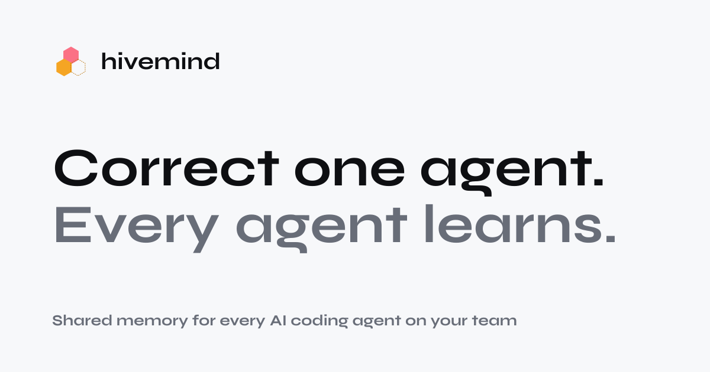
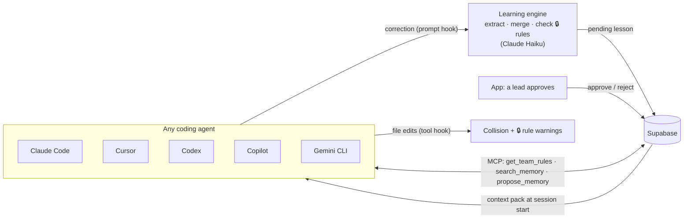

# Hivemind

**Persistent memory across your team's AI agents.** Correct one agent, and every agent on the team learns it.

**[Website](https://hivemind-beta-virid.vercel.app)** · **[Open the app](https://hivemind-beta-virid.vercel.app/app)** ·
[Eval](docs/eval.md) · [Devpost write-up](docs/pitch/devpost.md)



## The problem

Every coding agent starts each session knowing nothing about how your team works. A reviewer tells one engineer's
agent that exports must call `assertSingleCustomer()`. Next week a teammate's agent makes the same mistake in the same
file, and someone types the same correction again. The rule lived in a chat that closed.

## What Hivemind does

1. **A correction becomes a lesson.** `@alex` tells Claude Code *"No. Exports must call `assertSingleCustomer()`
   first."* Hivemind turns that into a short, attributed lesson, waiting for review.
2. **A person approves it.** `@jordan`, who leads that team, approves it in the app. Agents can only propose lessons.
   They can never approve them.
3. **Every agent follows it.** Each teammate's agent loads the team's lessons when its next session starts:
   Claude Code, Cursor, Codex, GitHub Copilot, Gemini CLI and Windsurf.
4. **Bad lessons don't get in.** Security can 🔒 lock a rule ("never mix data from different lab customers"). A
   lesson that contradicts it is blocked before any agent sees it, and nobody below Security can override it.
5. **It watches agents while they work.** If `@noor`'s Cursor agent edits a file `@alex`'s Claude Code just changed,
   Noor's agent is told to coordinate first.

## Does it work?

We gave headless Claude Code 12 coding tasks in a small repo whose conventions are written down nowhere, 3 runs each,
and graded every run with code (no LLM judge).

| What the agent got | Runs that broke the team's rule |
|---|---|
| No memory | **22 of 36** |
| A similar-length pack of 12 unrelated lessons (placebo) | 21 of 36 |
| **Hivemind's lessons** | **0 of 36** |

On held-out tasks, where the lesson came from a *different* task, violations went from 9 of 12 to 0 of 12. Task-level
sign test, p = 0.0078. Method, limitations and reproduction: [`docs/eval.md`](docs/eval.md).

## How it works



- **Session start:** a hook fetches a context pack: 🔒 rules first, then lessons ranked by confidence (Wilson lower
  bound on a Beta score) and scope, kept under 6,000 characters.
- **Corrections:** the prompt hook sends what the engineer typed. Claude Haiku decides whether it's a reusable rule,
  merges it into an existing lesson or adds a new one, and checks it against every 🔒 rule. New lessons are always
  pending.
- **Edits:** the tool hook records each file edit and warns when another agent touched the file in the last 10
  minutes.
- **Session end:** confidence goes up for lessons that held and down for ones that got corrected.
- **Other tools:** `hivemind init` writes each agent's own hook and MCP config ([`integrations/`](integrations/README.md)
  has the per-tool capability matrix). Clients without hooks (claude.ai, Claude Desktop) use the MCP tools.

## Try it

**Online:** the [website](https://hivemind-beta-virid.vercel.app) plays the whole story, and the
[app](https://hivemind-beta-virid.vercel.app/app) is the live approvals inbox and dashboard for the fictional company
*Meridian Data*. Switch roles in the top right to see what an engineer, a lead and Security can each do.

**Connect a repo** ([`cli/README.md`](cli/README.md)):

```bash
npm i -g ./cli
export HIVEMIND_TOKEN=<token> HIVEMIND_USER=<you>
cd your-repo
hivemind init            # wires Claude Code, Cursor, Codex, Copilot, Gemini CLI, Windsurf
hivemind status
hivemind check --staged  # team-rule violations as code frames; exits 1 while a 🔒 rule is broken
```

**Run it locally:**

```bash
pnpm install
node scripts/seed.mjs    # loads the Meridian Data demo into Supabase
pnpm dev
```

Put these in `.env.local`: `NEXT_PUBLIC_SUPABASE_URL`, `NEXT_PUBLIC_SUPABASE_PUBLISHABLE_KEY`, `SUPABASE_SECRET_KEY`,
`ANTHROPIC_API_KEY`, `HIVEMIND_TOKEN` (details in [`docs/deploy.md`](docs/deploy.md)). With none of them set, the app
still renders on seed data.

## Repo map

| Path | What's there |
|---|---|
| `src/app/api/` | The API: context pack, hooks, memories (approve / reject), metrics, MCP server |
| `src/lib/engine/` | Learning engine: extraction, merging, 🔒 conflict checks, ranking |
| `src/components/hm/`, `src/app/(ui)/` | The app (Lessons, Approvals, Results) |
| `src/components/site/` | The website |
| `hooks/`, `integrations/`, `cli/` | Agent hooks, per-tool adapters, the `hivemind` CLI |
| `vscode-extension/` | Lessons and 🔒 squiggles inside the editor |
| `eval/` | The eval: fixture repo, 12 tasks, graders, runner, committed results |
| `demo/export-service/` | The demo repo, wired to every agent |
| `supabase/migrations/` | Database schema |
| `docs/` | Eval write-up, API, deploy, hooks setup, pitch |

## Team

Built at **SEP Hacks 2026** (Grand Tech: Continual Learning) by Michael (learning engine, agent integrations) and
Adrian (product, UI, design), each running Claude Code with planner, implementer and verifier subagents.
